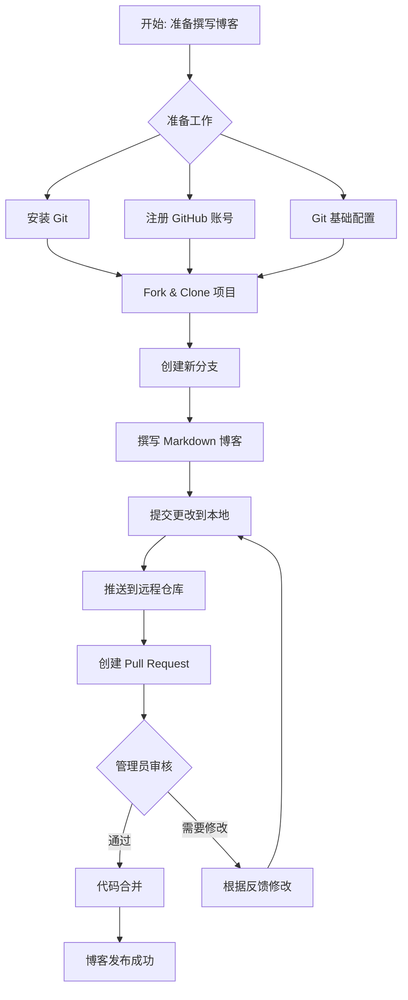

# 撰写并发布你的第一篇 NBTCA 博客

本指南说明怎样用 Git、Markdown 和 Pull Request 撰写并发布你的第一篇 [NBTCA](/about/what-is-nbtca) 博客。通用的 Git 协作流程见[快速上手 GitHub 工作流](/tutorial/manual/github-workflow)。本文只说明博客投稿特有的部分。

## 流程



## 准备工作

### 安装 Git

- **Windows**：从 <https://git-scm.com/downloads> 下载安装程序，使用默认选项安装。
- **macOS**：先安装命令行工具，再用 Homebrew 安装 Git：

  ```bash
  xcode-select --install
  brew install git
  ```

- **Linux**：用发行版的包管理器安装 Git：

  ```bash
  sudo apt install git      # Debian、Ubuntu
  sudo pacman -S git        # Arch
  ```

### 注册 GitHub 账号

在 <https://github.com> 注册并登录。

### 设置 Git 署名

```bash
git config --global user.name "你的名字"
git config --global user.email "你的邮箱"
```

你也可以用 [GitHub CLI](https://github.com/cli/cli) 完成 GitHub 认证。但你仍然要掌握 [Git 的工作流程](https://nbtca.space/posts/blogs/Tech/Git/git-book-1)。

### 安装 Node 和 pnpm

提交前要在本地构建博客，所以需要 Node 和 pnpm。安装方法见[配一台能跑本站的电脑](/tutorial/manual/local-dev-setup)的第四步。

## 获取博客仓库

博客在 [Home 项目](https://github.com/nbtca/home)中。Home 项目使用 [CI/CD](https://github.com/resources/articles/ci-cd)：PR 合并进 `main` 后，[GitHub Actions](https://github.com/features/actions) 自动构建并发布网站。PR 本身不触发构建。

1. 如果你没有 Home 仓库的写权限，先把它 [Fork](https://docs.github.com/en/pull-requests/collaborating-with-pull-requests/working-with-forks/fork-a-repo) 到你自己的账号下。有写权限的成员跳过这一步。
2. 克隆仓库。没有写权限时，克隆你自己的 Fork；有写权限时，克隆源仓库：

   ```bash
   # 没有写权限：克隆你的 Fork
   git clone https://github.com/你的用户名/home.git

   # 有写权限：克隆源仓库
   git clone https://github.com/nbtca/home.git
   ```

3. 进入仓库目录：

   ```bash
   cd home
   ```

4. 安装依赖：

   ```bash
   pnpm install
   ```

## 创建分支

```bash
git checkout -b post/my-first-blog
```

`-b` 表示创建一个新分支。分支名的常用格式是“类型/内容”，例如 `post/my-first-blog` 或 `feature/homepage`。

## 撰写博客

1. 在 `src/pages/posts/` 文件夹中新建一个 Markdown 文件，例如 `my-first-blog.md`。文件名用英文。
2. 按下面的模板填写元信息和正文：

   ```markdown
   ---
   layout: "../../layouts/MarkdownPost.astro"
   title: "题目"
   pubDate: 2025-10-10
   description: "描述"
   author: "张三"
   cover:
     url: "封面地址url，也可以引用本地图片"
     alt: "cover"
   tags: ["标签", "可多个"]
   ---

   # Git 与 Markdown 入门指南

   大家好，我是计算机协会新社员张三。

   本文将介绍如何使用 Git 与 Markdown 撰写并提交博客。

   ## 一、Git 是什么？

   Git 是一个分布式版本控制系统，用于多人协作开发。

   ## 二、Markdown 是什么？

   Markdown 是一种轻量级标记语言，用简单的符号来排版文字。

   - **加粗**：`**加粗**`
   - _斜体_：`*斜体*`
   - 链接：`[协会官网](https://example.com)`

   ## 三、总结

   学会使用 Git + Markdown，你就能参与到开源协作中了！
   ```

Markdown 的完整语法见 [Markdown Guide](https://www.markdownguide.org/)。

## 构建、提交和推送

::: warning 注意
提交前，必须在本地构建一次。PR 不触发构建，所以构建错误要到合并后才会出现，并使网站不能更新。
:::

1. 构建网站，确认没有错误：

   ```bash
   pnpm build
   ```

2. 把文件添加到暂存区：

   ```bash
   git add src/pages/posts/my-first-blog.md
   ```

3. 提交，并写明这次提交的内容：

   ```bash
   git commit -m "Add my first blog: Git 与 Markdown 入门"
   ```

4. 把提交推送到 GitHub 上的同名分支：

   ```bash
   git push origin post/my-first-blog
   ```

## 创建 Pull Request

1. 在 GitHub 上打开你推送的仓库。
2. 单击“**Compare & pull request**”。
3. 确认目标仓库是 `nbtca/home`，目标分支是 `main`。
4. 填写标题和说明，例如“新增一篇关于 Git 的博客”。
5. 单击“Create pull request”。

## 等待合并

管理员 [Review](https://github.com/features/code-review) 你的 PR。如果需要修改，在同一个分支上修改、提交并推送，PR 自动更新。评审通过后，管理员把 PR [Merge](https://docs.github.com/en/pull-requests/collaborating-with-pull-requests/incorporating-changes-from-a-pull-request/merging-a-pull-request) 进 `main`，博客自动发布。

## 常见问题

| 问题                 | 处理方法                                                              |
| -------------------- | --------------------------------------------------------------------- |
| push 时提示拒绝访问  | 确认你推送的是自己的 Fork，或者你有源仓库的写权限。确认你已登录 GitHub。 |
| 提交了错误的文件     | 用 `git status` 查看状态，用 `git reset` 撤销提交。                   |
| PR 没有被合并        | 等待管理员的审核意见，按意见修改。                                    |

## 推荐工具

- 编辑器：[VS Code](https://code.visualstudio.com/)、[Neovim](https://neovim.io/)、[Typora](https://typora.io/)
- Markdown 预览插件：[Markdown Preview Enhanced](https://github.com/shd101wyy/markdown-preview-enhanced)
- Git 图形界面工具：[GitHub Desktop](https://desktop.github.com/)、[Sourcetree](https://www.sourcetreeapp.com/)
