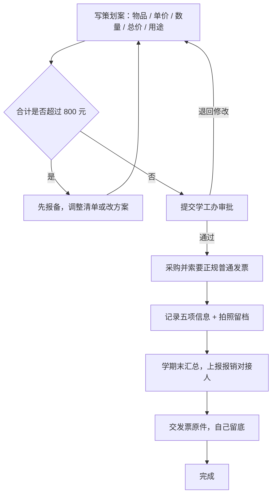

# 活动经费报销流程

社团为活动或工作采购后，可以把费用报销回来。核心是四件事：**先在策划案里写清预算、审批通过后再采购、开正规普通发票并如实记录、学期末把发票原件交给报销对接人**。

> 一句话顺序：**先审批、后采购** —— 未批先买的部分，期末不予报销。

## 流程

| 步骤 | 做什么 | 关键产出 |
| :--- | :--- | :--- |
| ① 写策划案 | 把要买的东西和预算写进去 | 含预算表的策划案 |
| ② 交审批 | 报学工办审批 | 审批通过记录 |
| ③ 采购开票 | 通过后下单，索要普票 | 发票 + 五项记录 |
| ④ 学期末报销 | 汇总上报、交原件 | 汇总表 + 发票原件 |

---

## 1. 第一步：写策划案（含预算）

老师的原话是「**策划案里包括预算**」。预算写不清，审批就过不了。

### 1.1 四项要求

| 要求 | 说明 |
| :--- | :--- |
| 用途写具体 | 哪场活动、哪个环节、修哪台设备，一句话说清。 |
| 物品列成清单 | 名称写全称和型号，别只写「维修工具」。 |
| 单价 × 数量 = 总价 | 三个数都要有，单价要能对上报价。 |
| 合计卡住 800 元 | 含运费包装的总额；超了先报备，再改方案。 |

### 1.2 一句话写法

> 「为机房设备散热维护采购导热硅脂 2 支，单价 30 元，合计 60 元；另购精密螺丝刀套装 1 套，65 元。」

拆开看就是四个要素：

| 要素 | 内容 |
| :--- | :--- |
| 用途 | 机房设备散热维护 |
| 物品 | 导热硅脂 / 螺丝刀套装 |
| 单价 × 数量 | 30 元 × 2 支 |
| 合计 | 60 元（总额 ≤ 800 元） |

### 1.3 预算表模板（贴在策划案末尾）

| 物品名称 | 单价（元） | 数量 | 总价（元） | 用途说明 |
| :--- | ---: | ---: | ---: | :--- |
| 导热硅脂（2g 装） | 30.00 | 2 | 60.00 | 机房设备散热维护 |
| 精密螺丝刀套装 | 65.00 | 1 | 65.00 | 设备拆装与维修 |
| 数字万用表 | 158.00 | 1 | 158.00 | 电路与线路检测 |
| 电烙铁套装 | 189.00 | 1 | 189.00 | 焊点修复 |
| 扎带 / 热缩管 | 36.00 | 1 | 36.00 | 线缆整理 |
| **合计** | — | — | **508.00** | **≤ 800 元 ✓** |

合计 508 元，还有余量；若合计要超过 800 元，先报备、再调整清单，**不要先买后补**。

---

## 2. 第二步：提交审批

审批不是形式 —— 它决定这笔钱期末能不能报回来。

### 2.1 审批流程

1. **提交策划案** —— 含预算表与报价。
2. **学工办审批** —— 看用途、预算、金额。
3. **出结果** —— 通过，或退回修改。
4. **通过后采购** —— 拿着同意再去下单。

### 2.2 审批看三件事

- **用途**：是不是活动或工作真的需要？
- **预算**：五项信息是否齐全、合计是否 ≤ 800 元。
- **物品**：买什么要提前报备，临时加购要补说明。

### 2.3 三条硬规矩

| # | 规矩 | 后果 |
| ---: | :--- | :--- |
| 1 | 未批先买 | 期末不予报销 |
| 2 | 合计超过 800 元 | 先报备再调整 |
| 3 | 买什么没提前说 | 先补策划案 |

> 老师原话：「先给策划案，策划案审批通过后再去采购。」先递材料，再动手花钱。

---

## 3. 第三步：采购与开票

报销的核心凭证是发票 —— 开错一个字，等于白买。

### 3.1 开票四要点

| 要点 | 说明 | 备注 |
| :--- | :--- | :--- |
| 必须是正规发票 | 电子普票也可以，截图不算凭证。 | 补开发票很麻烦，别图省事 |
| 只开普通发票 | 一律开「普票」，不开专票、不收据。 | 专票、收据都报不了 |
| 抬头开单位 | 个人抬头报不掉。 | 开票前把信息复制过去 |
| 京东选数电普票 | 平台下单时选「数电普票」。 | 别默认选个人 / 不开发票 |

### 3.2 开票信息（统一，照抄）

请统一开具**普通发票（普票）**，开票信息如下：

| 项目 | 信息 |
| :--- | :--- |
| 抬头 | 浙大宁波理工学院后勤发展有限公司 |
| 税号 | 91330212739470000Q |
| 地址 | 宁波市鄞州区钱湖南路 1 号 |
| 电话 | 0574-88229116 |
| 开户行及账号 | 农业银行天一支行 39056001040002991 |

### 3.3 京东开票填写（数电普票）

京东平台请选择：**数电普票**。

| 字段 | 填写内容 |
| :--- | :--- |
| 发票抬头 | 单位 |
| 单位名称 | 浙大宁波理工学院后勤发展有限公司 |
| 纳税人识别号 | 91330212739470000Q |
| 注册地址 | 宁波市鄞州区钱湖南路 1 号 |
| 注册电话 | 0574-88229116 |
| 开户银行 | 农业银行天一支行 |
| 银行账号 | 39056001040002991 |

### 3.4 采购记录（买完马上记，五项缺一不可）

| 物品名称 | 单价（元） | 数量 | 总价（元） | 用途说明 |
| :--- | ---: | ---: | ---: | :--- |
| 示例：导热硅脂 | 30.00 | 2 | 60.00 | 机房设备散热维护 |

填写要求：

- **物品名称**：写全称和型号。
- **单价**：每件多少钱，必须填。
- **数量**：买了几件，必须填。
- **总价**：按「单价 × 数量」计算，必须填。
- **用途**：写明具体使用场景，避免只写「活动使用」等笼统描述。

> 别忘了：发票照片、支付记录、实物照片，三张一起存 —— 缺一样，期末就要来回补。

---

## 4. 第四步：学期末统一报销（一学期一次）

平时攒票、期末汇总，上报对接人并交发票原件。

| 时间 | 动作 | 具体做法 |
| :--- | :--- | :--- |
| 买完当天 | 记录 + 拍照 | 填好五项信息，发票、支付、实物各拍一张，进同一个相册。 |
| 平时 | 集中存放 | 发票原件放进一个信封 / 文件夹，别随手塞书包。 |
| 学期末 | 汇总上报 | 按时间排成一张清单，报给当年的报销对接人。 |
| 交件 | 原件交接 + 留档 | 交发票原件；自己先拍照留底，后续核对有据可查。 |

> 一般一学期只报一次 —— 期末集中处理，错过就要等下一学期。

### 4.1 学期末手上要有这六样

- [ ] **策划案（含预算表）** —— 证明为什么买、买多少
- [ ] **审批通过记录** —— 聊天或签字截图
- [ ] **发票原件** —— 普票、抬头是单位
- [ ] **采购记录表** —— 五项信息齐全
- [ ] **支付记录** —— 金额、日期与发票一致
- [ ] **拍照留档** —— 发票 / 实物 / 记录

> 报销表与当年的报销对接人由学工办指定，模板没到手也能先备料：表一到，只是把已有内容抄进去而已。

---

## 5. 金额红线：¥800

| 规则 | 说明 |
| :--- | :--- |
| 按总额算 | 含税、含运费的最终支付金额，不是商品标价。 |
| 按批次算 | 同一次采购的所有物品合并计算，不按单件拆开。 |
| 超了先报备 | 写清原因、重新提交策划案，通过后再买。 |

> 举例：3 件 × 300 元 = 900 元，超 100 元 —— 先报备，或减量。

---

## 6. 常见问题

**Q：先买后补审批可以吗？**
不可以。未批先买的部分期末不予报销，等于自己垫钱。

**Q：金额刚好 800 元行不行？**
行，「不得超过 800」即 800 元以内（含 800）；但要把运费、包装算进去。

**Q：截图能当发票吗？**
不能。截图只是记录，凭证必须是正规发票，且是普通发票。

**Q：发票开成个人抬头怎么办？**
个人抬头报不掉，只能作废重开。赶不上期末就得等下一轮，所以开票前先核对。

**Q：报销表还没发，现在能做什么？**
先把六样材料备齐（见 4.1）；表一到直接誊写。

---

## 7. 一句话总结

> **先审批、后采购；票开普票，抬头开单位。一学期结一次。**

下一步：把要买的东西写进策划案（含单价、数量、总价、用途，合计 ≤ 800 元）→ 交学工办审批 → 通过后采购开票 → 学期末汇总上报、交发票原件。
