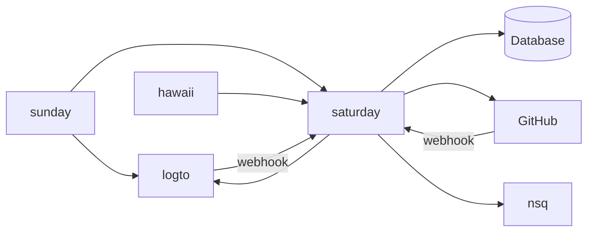
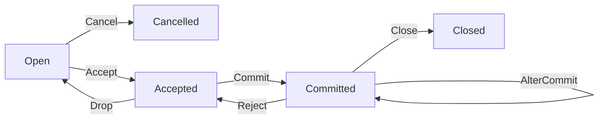
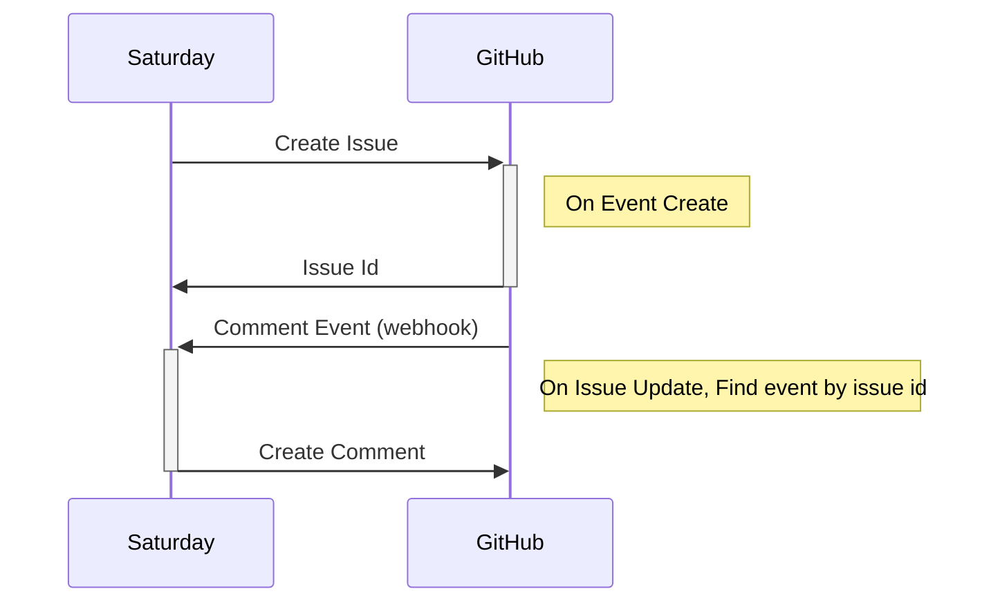
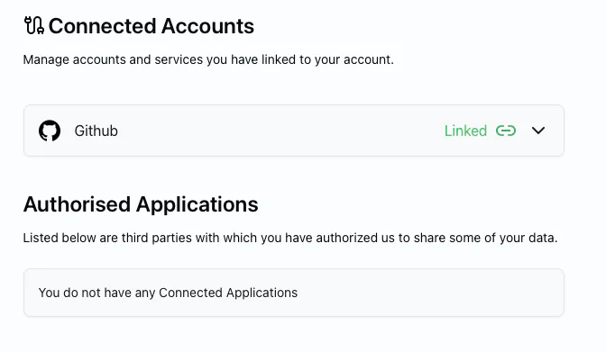
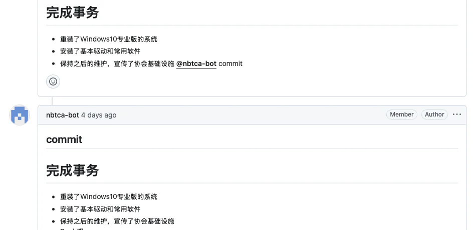
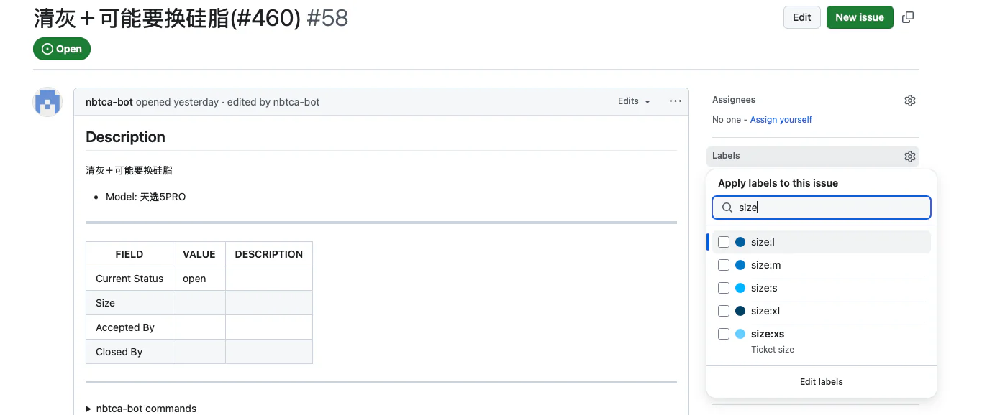

---
maintainers:
  - user: wen-templari
    since: 2025-04
---

# 维修工单系统 (weekend)

维修工单系统（内部代号 weekend）是 NBTCA 自建的报修和维修协作系统。校内任何人都可以通过报修入口报修。维修事件在后端和 GitHub 之间同步。队员用机器人命令接单、提交和审核，系统据此统计[志愿者时长](/concepts/volunteer-hours)。

::: info 注
本文记录这套系统设计完成时的状态。后来有两处改变：

- **报修和工单管理都已移到协会主页的 [/repair](https://nbtca.space/repair)**。本文写作时的两个入口，[微信小程序](/concepts/repair-miniprogram)和 repair.nbtca.space，都已停止维护（[Roadmap#64](https://github.com/nbtca/Roadmap/issues/64)）。
- **工单不再使用 GitHub Issue**。下文“在 GitHub 上处理维修”一节的做法（`@nbtca-bot` 命令、用标签记录工作量）已经停用。队员现在在主页的维修面板上接单和结单。

事件状态机和角色权限没有改变。工作量分档和时长规则也没有改变：队员在维修面板上提交维修记录时，选择 `xs` 到 `xl` 的工作量；导出时，按下文的基础时长和上限计算。实现见 [Saturday](/concepts/saturday)。最后核对：2026-09。
:::

## 总览



| 地址                                 | 仓库                                                    | 描述                       |
| ------------------------------------ | ------------------------------------------------------- | -------------------------- |
| <https://repair.nbtca.space/api>     | [nbtca/saturday](https://github.com/nbtca/saturday)     | 后端                       |
| <https://repair.nbtca.space>         | [nbtca/sunday](https://github.com/nbtca/sunday)         | 管理页面                   |
| NA                                   | [nbtca/Hawaii](https://github.com/nbtca/Hawaii)（私有） | 微信小程序，用于报修       |
| <https://auth-admin.app.nbtca.space> | [logto-io/logto](https://github.com/logto-io/logto)     | 鉴权                       |
| NA                                   | [nsqio/nsq](https://github.com/nsqio/nsq)               | 消息队列，用于推送维修事件 |

## 角色

| 角色名 | 权限描述                             |
| ------ | ------------------------------------ |
| client | 创建维修事件，取消事件               |
| member | 接受维修事件，提交维修描述，放弃事件 |
| admin  | 审核维修描述，关闭事件, 添加member   |

### 维修人员基本信息

为了管理员验证成员身份，以及后续申报[志愿者时长](/concepts/volunteer-hours)，需要收集成员的个人信息。

| 字段名    | 描述     |
| --------- | -------- |
| member_id | 学号     |
| name      | 真实姓名 |
| phone     | 手机号   |
| qq        | QQ号     |

## 维修事件



### 事件状态(status)

| 状态名 | status    | 描述                                 |
| ------ | --------- | ------------------------------------ |
| 待处理 | open      | 维修事件未被成员接受                 |
| 取消   | cancelled | 维修事件被用户取消，不需要再进行处理 |
| 受理   | accepted  | 维修事件已被成员接受                 |
| 待审核 | committed | 成员提交了维修描述，管理员尚未审核   |
| 关闭   | closed    | 维修事件已解决，不能再更改该事件     |

### 事件行为(action)

| 操作名   | action      | 操作权限       | 事件状态变更           | 描述                                         |
| -------- | ----------- | -------------- | ---------------------- | -------------------------------------------- |
| 创建     | create      | client         | nil => open            | 用户创建了维修事件                           |
| 受理     | accept      | member, admin  | open => accepted       | 成员接受了维修事件                           |
| 取消     | cancel      | current client | open => cancelled      | 用户取消了自己创建的维修事件                 |
| 放弃     | drop        | current member | accepted => open       | 成员放弃了自己接受的维修事件                 |
| 提交     | commit      | current member | accepted => committed  | 成员维修完成，添加维修描述后提交给管理员审核 |
| 修改提交 | alterCommit | current member | committed => committed | 成员修改 未被审核的维修提交                  |
| 拒绝提交 | reject      | admin          | committed => accepted  | 管理员拒绝提交                               |
| 关闭     | close       | admin          | committed => closed    | 管理员通过提交                               |
| 修改     | update      | current client | open => open           | 用户修改自己尚未被受理的维修事件             |

## 在 GitHub 上处理维修



::: info 注
这一节的做法已经停用。自动建单的量被 GitHub 判定为滥用，[repair-tickets](https://github.com/nbtca/repair-tickets) 的 issue 随之受限，邮件申诉未能恢复，工单管理因此迁回协会主页的[维修面板](https://nbtca.space/repair/admin)。同步逻辑仍留在 [Saturday](https://github.com/nbtca/Saturday) 的代码里（`util/github.go`），每个动作都还会尝试同步，但 2025 年 5 月之后创建的工单已经关联不上 issue。

这一节作为记录保留。它说明了当初选择 GitHub Issue 的原因，也记录了把工单放在外部平台上遇到的问题。最后核对：2026-08。
:::

这套做法运行时，新的维修事件同步到 [GitHub Issue](https://github.com/nbtca/repair-tickets/issues)。成员在 GitHub Issue 中处理维修事件。

### 为什么用 GitHub Issue 管理维修

- **成熟的工单系统**：GitHub Issue 是成熟的工单系统，功能完整，容易使用。
- **可追溯性**：所有维修事件都可以在 GitHub 上查看，方便后续的查询和统计。
- **协作**：GitHub Issue 提供协作工具，成员可以在上面讨论。
- **自动化**：通过 GitHub 的 Webhook，可以自动化处理一些事件，比如创建事件、更新事件等。
- **社区参与**：GitHub 是开放的平台，任何人都可以参与到维修事件中来，增加了社区的参与度。
- **版本控制**：所有的事件都有版本记录，可以随时查看历史记录，方便追踪和审计。
- **标签管理**：可以通过标签来管理事件的状态和类型，方便后续的查询和统计。

### 前提条件

开始前，在 [MyId](https://myid.app.nbtca.space/account/connections) 关联你的 GitHub 账户。



### 处理事件

在 GitHub Issue 的回复中写下面的命令，处理事件：

- `@nbtca-bot accept` will accept this ticket
- `@nbtca-bot drop` will drop your previous accept
- `@nbtca-bot commit` will submit this ticket for admin approval
- `@nbtca-bot reject` will send this ticket back to assignee
- `@nbtca-bot close` will close this ticket as completed



### 记录事件工作量



在 GitHub Issue 中，用标签记录工作量。标签有 `size:xs`、`size:s`、`size:m`、`size:l`、`size:xl` 五种。工作量表示维修事件的复杂程度和所需时间。标签和工作量的对应关系如下：

| 标签名    | 对应时长 | 示例维修任务（仅供参考）                        | 场景说明                                         |
| --------- | -------- | ----------------------------------------------- | ------------------------------------------------ |
| `size:xs` | 0.5 小时 | 重启系统、插拔键鼠、调整BIOS启动项              | 无需工具，仅简单排查或软件层级操作               |
| `size:s`  | 1 小时   | 更换键盘、电源适配器、内存条                    | 简单拆装部件，操作快，风险低                     |
| `size:m`  | 2 小时   | 拆机清灰、重新安装操作系统、驱动修复            | 需基本工具、一定技术判断，时间较长               |
| `size:l`  | 4 小时   | 主板故障检测与更换、电源模块更换                | 较复杂的拆装和测试流程，需熟练技能、多人协作可能 |
| `size:xl` | 8 小时   | 批量电脑检修（5 台以上）、全室网卡/主板统一更换 | 工作量极大，涉及多个设备，需团队作业和详细记录   |

### 志愿者时长统计

志愿者时长根据记录的工作量统计。

```typescript
const BASE_TIME = 2 // hours
const MAX_TIME = 8 // hours

// Mapping from tag to time in hours
const tagTimeMap: Record<string, number> = {
  'size:s': 1,
  'size:m': 2,
  'size:l': 4,
  'size:xl': 8,
}

// Compute total time for a given student and event
function calculateTime(records: {
  studentId: string
  eventId: string
  tag: string // e.g., "size:s"
}[], studentId: string): number {
  const relevantRecords = records.filter(
    r => r.studentId === studentId
  )

  let totalTime = BASE_TIME

  for (const record of relevantRecords) {
    const time = tagTimeMap[record.tag] || 0
    totalTime += time
  }

  return Math.min(MAX_TIME, totalTime)
}

const records: Record[] = [
  { studentId: '2333333333', eventId: '123456', tag: 'size:s' },
  { studentId: '2333333333', eventId: '123456', tag: 'size:m' },
]
const time = calculateTime(records, '2333333333')
console.log('Calculated time:', time) // Output: 5
```

| Key            | Value     | Description              |
| -------------- | --------- | ------------------------ |
| 基础时长       | 2         | 每个志愿者的基础时长     |
| 最高时长       | 8         | 每个志愿者的最高申报时长 |
| 上一次统计日期 | 2025.4.21 | 上一次统计时长的日期     |

统计时长时，读取上一次统计日期之后的维修记录。统计完成后，把上一次统计日期改为当天。

时长按上面代码中的 `calculateTime` 函数计算。Saturday 的实际实现与这段示例代码有两处不同：`xs` 计 0.5 小时；没有标记工作量的工单也计 0.5 小时，不是 0。

#### 例子

| 学号       | 事件ID | size   |
| ---------- | ------ | ------ |
| 2333333333 | 123456 | size:s |
| 2333333333 | 123456 | size:m |

计算后时长为 min(8，2 + 1 + 2) = 5。

#### 用 Saturday API 把时长导出为 Excel

| 字段名       | 描述                 |
| ------------ | -------------------- |
| start_time   | 开始时间             |
| end_time     | 结束时间             |
| bearer_token | token，需要admin权限 |

```http
GET https://repair.nbtca.space/api/events/xlsx?start_time={{start_time}}&end_time={{end_time}}
Authorization: {{bearer_token}}
```

##### 示例

```bash
curl -X GET "https://repair.nbtca.space/api/events/xlsx?start_time=2025-01-01&end_time=2025-05-31" \
  -H "Authorization:  {{bearer_token}}" \
  -OJ
```
