# 快速上手 NBTCA 的 GitHub 工作流

NBTCA 在 GitHub 上管理事务和代码。每件事用一个 Issue 跟踪。修改在自己的分支上完成，再通过 Pull Request 请求合并，由其他人评审。本文带你完整地走一遍这个流程。

## 为什么使用 GitHub 工作流

NBTCA 的工作常有下面几种情况：

- 多个成员参与同一件事；
- 同一时间有多件事在进行；
- 不同时间段的事情并行推进。

GitHub 工作流用 [Git](https://git-scm.com) 管理这些工作。很多事务也与协会的代码库直接相关。

## 基本概念

- **Issue**：一件事的跟踪单。谁在做、讨论的内容和完成状态都记录在 Issue 中。
- **分支（branch）**：你自己的工作区。分支上的修改不影响主分支。
- **Pull Request（PR）**：请求把你的修改合并到主分支。PR 也是评审和讨论的地方。
- **合并（merge）**：评审通过后，修改进入主分支，这件事完成。

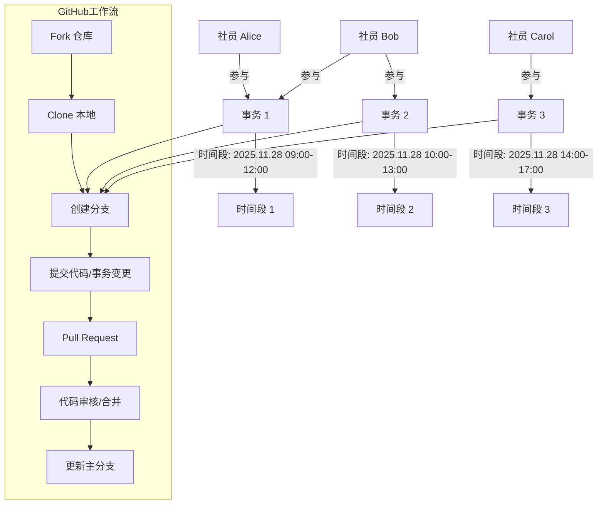

## 查看和参与事务

1. 打开 [Roadmap](/concepts/roadmap)。

   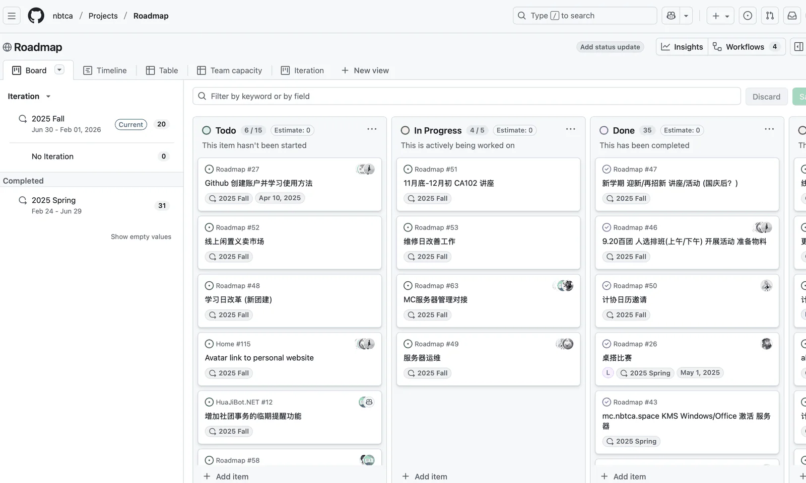

2. 打开一个你感兴趣的 Issue。

   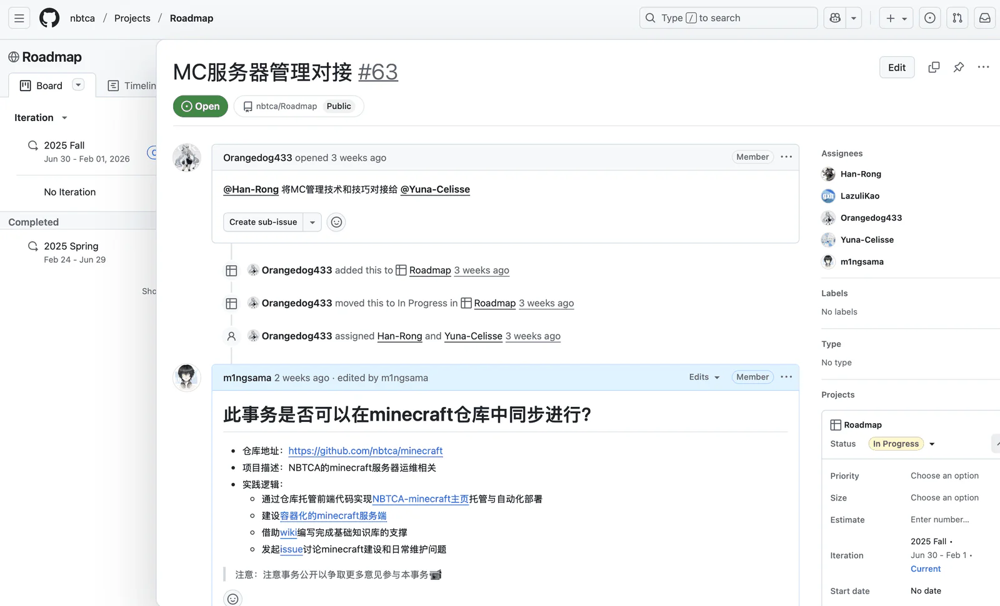

3. 在 Assignees 中查看或添加负责人。

   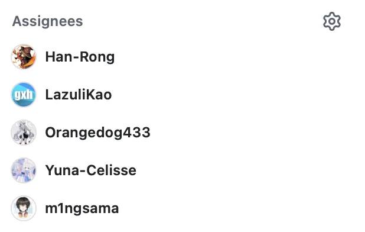

4. 在 Labels 中设置标签，用于分类。

   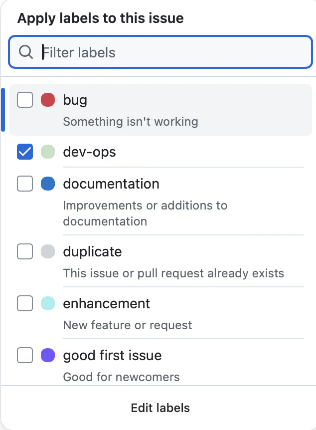

5. 单击 Subscribe，订阅通知。通知发送到你的邮箱。

   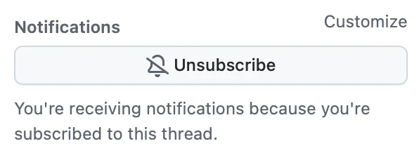

Issue 的内容支持 Markdown 语法。

你也可以在终端中用 GitHub CLI 查看 Issue：

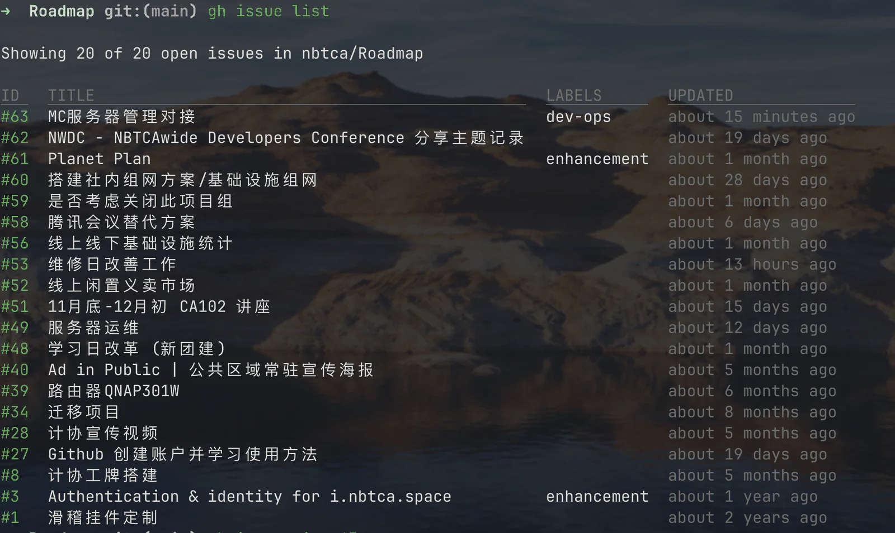

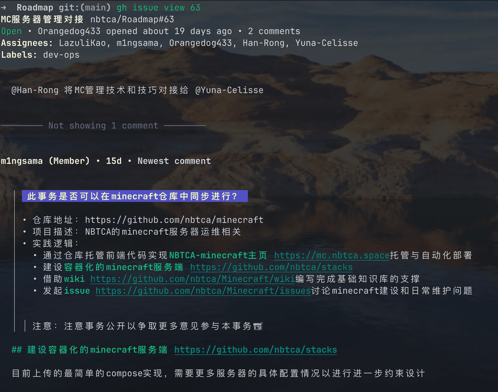

## 修改仓库中的文件

下面以修改 [Minecraft 仓库的 wiki](https://github.com/nbtca/Minecraft/wiki) 为例。

1. 打开 wiki 页面。

   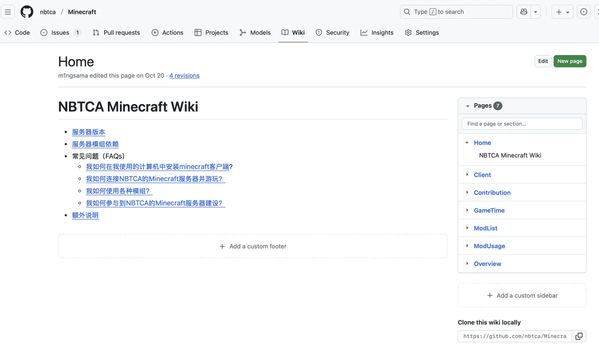

2. 在 GitHub 上查看 wiki 的源文件。

   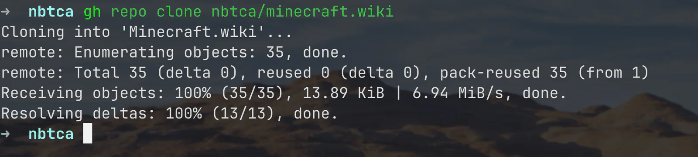

   你也可以用 git 命令克隆 wiki：

   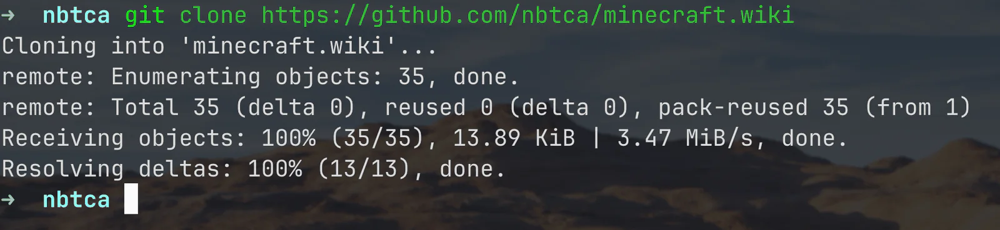

3. 编辑文件。

   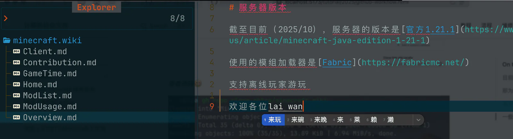

4. 提交修改。

   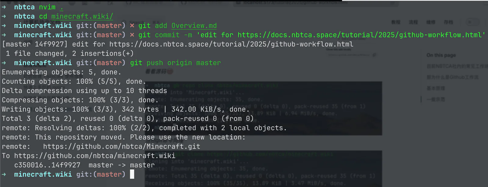

5. 确认页面显示提交成功。

   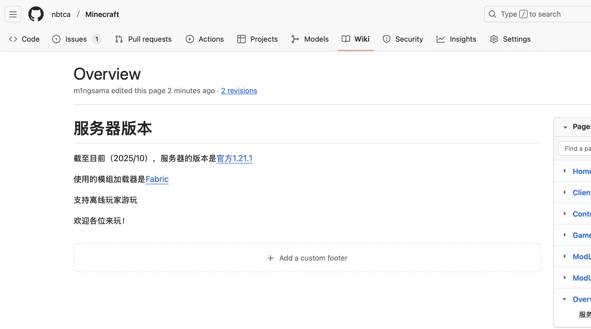

## 用 Pull Request 提交修改

大多数多人协作的仓库都保护主分支。主分支必须随时可用，所以不能直接向主分支提交。所有修改先提交到自己的分支，评审通过后再合并。

1. 在你自己的分支上编辑和提交。

   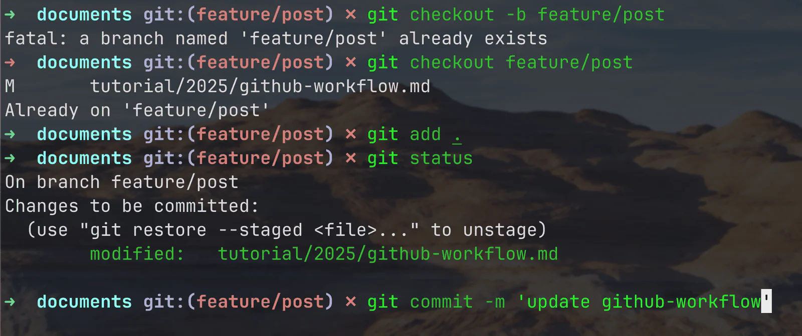

2. 向主分支创建一个 Pull Request。下图以提交本文为例。

   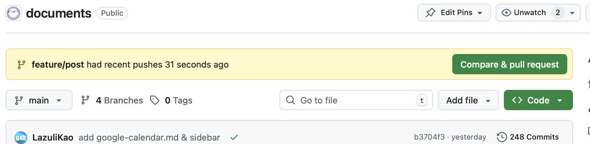

3. 填写 PR 的内容。在右上角的 Reviewers 中选择评审人。

   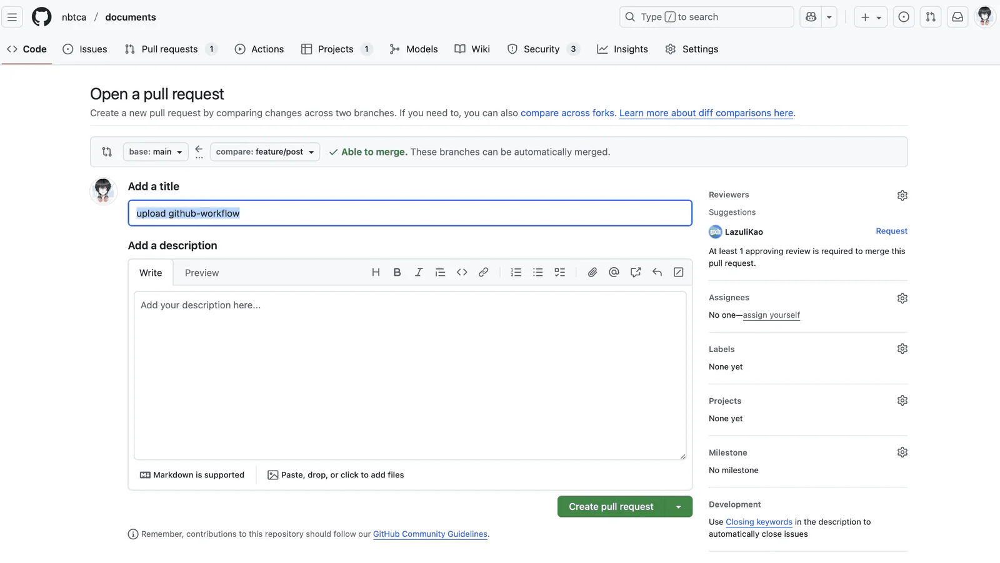

4. 如果要在评审通过后自动合并，启用 Auto-Merge。

   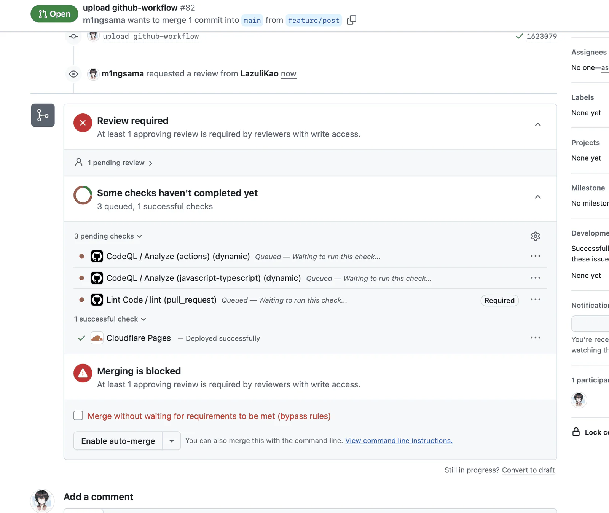

评审人看到的页面如下：

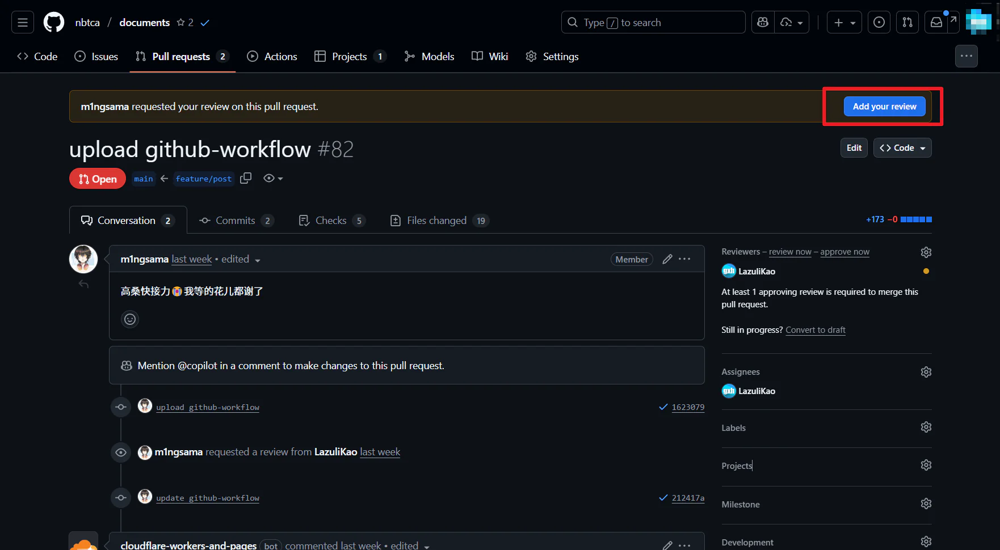

评审人的操作：

1. 单击 Approve，批准修改。

   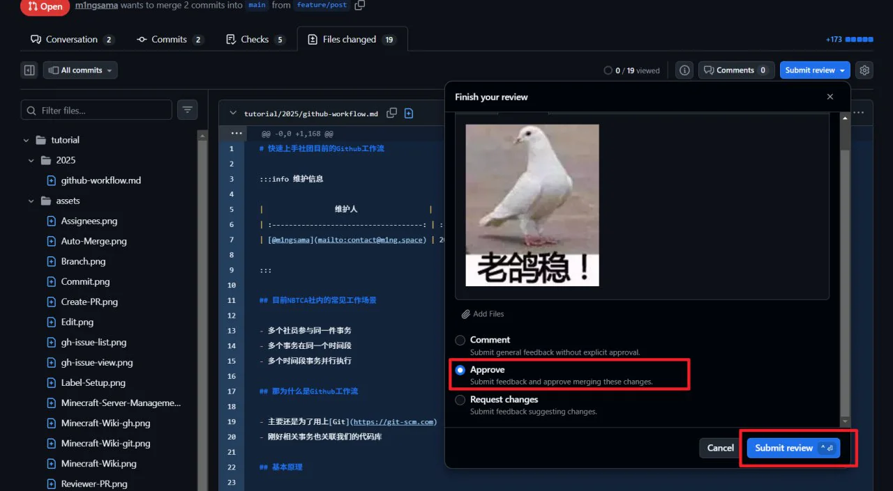

2. 单击 Merge，合并修改。

   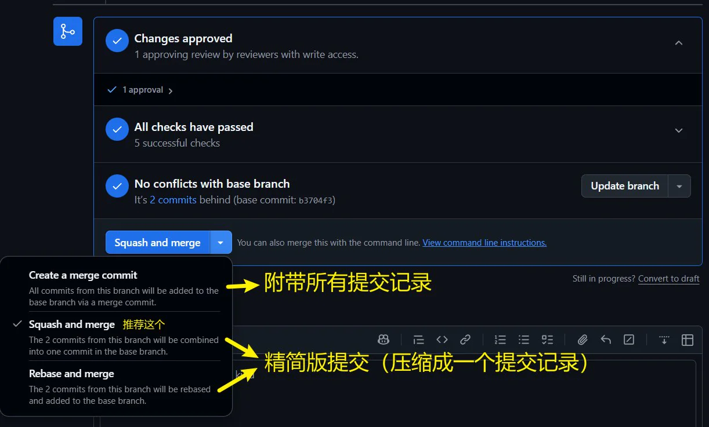

合并后，这件事完成。如果你想参与编写手册，见[写一页文档](/tutorial/manual/writing-documents)。
